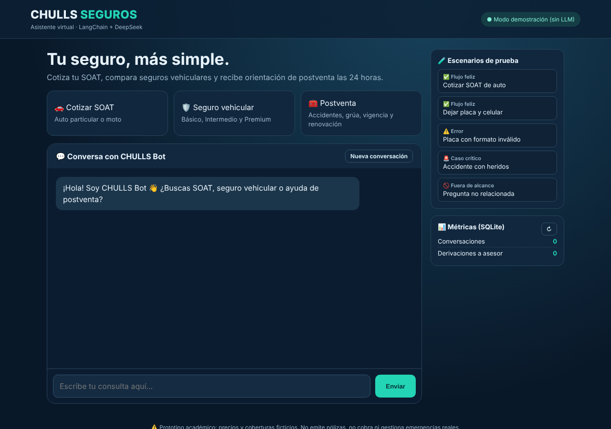
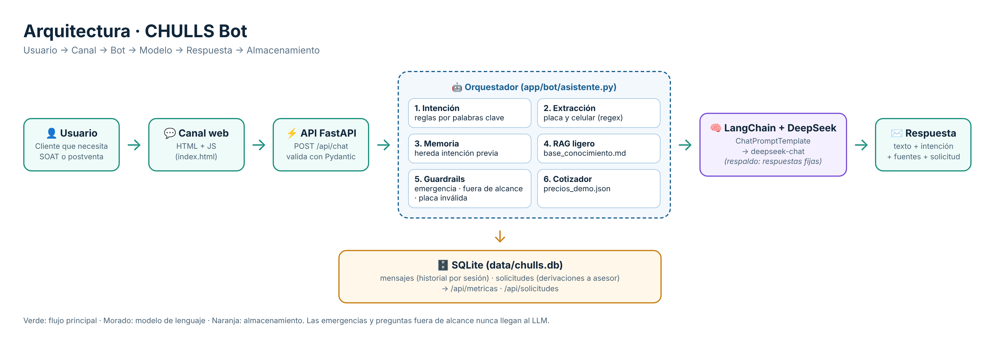
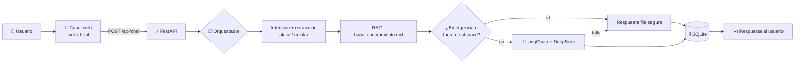
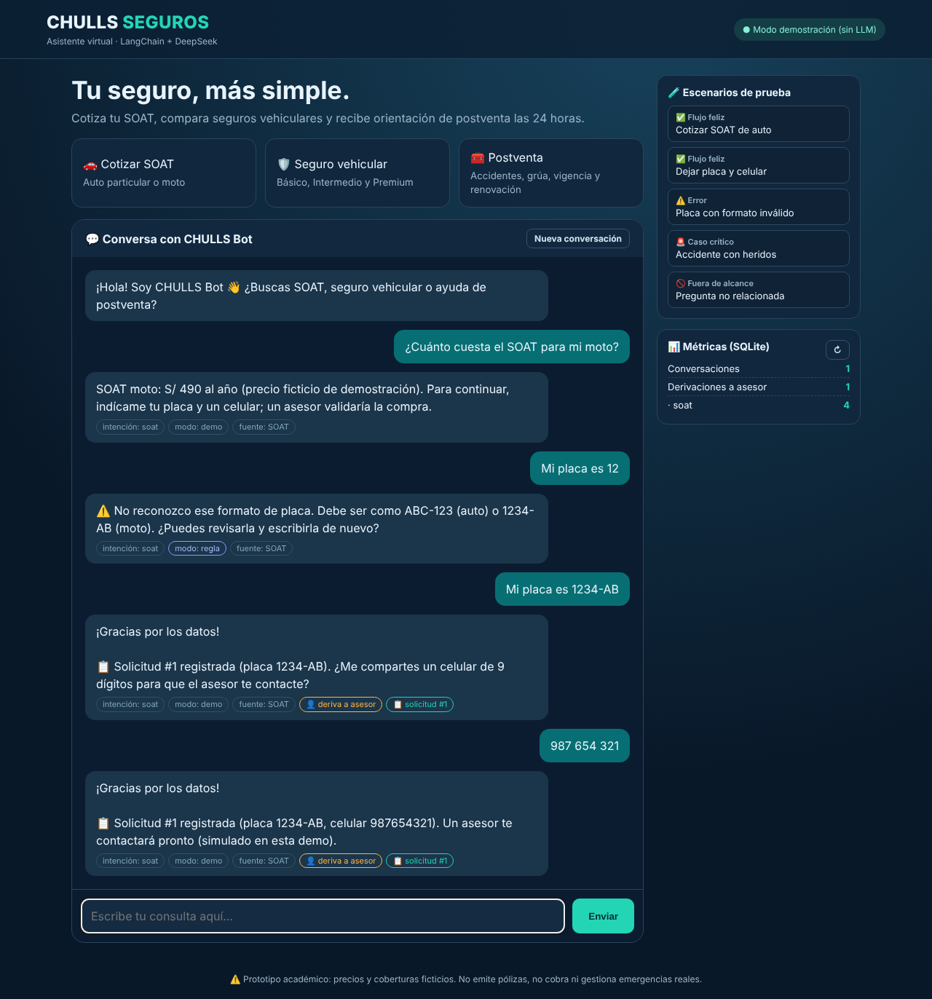
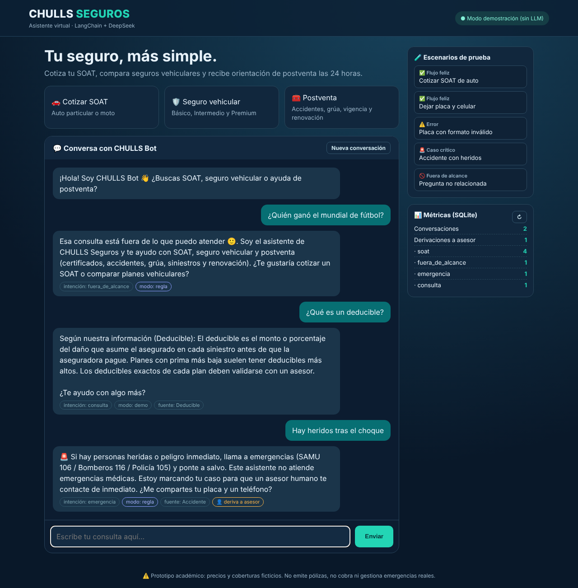

# 🚗 CHULLS Bot — Asistente virtual de seguros vehiculares

Chatbot para **CHULLS Seguros** (empresa ficticia, Perú) que cotiza **SOAT**, compara **planes de seguro vehicular** y orienta en **postventa** (accidentes, grúa, vigencia, siniestros y renovación). Cuando hace falta, **deriva el caso a un asesor humano** y registra la solicitud.

Construido con **Python · FastAPI · LangChain · DeepSeek · SQLite**.

> ⚠️ Proyecto académico (Diploma en Diseño e Implementación de Chatbots). Precios, coberturas y procesos son **ficticios**. No emite pólizas, no cobra y no gestiona emergencias reales.



---

## 📌 Problema y solución

| | |
|---|---|
| **Problema** | El cliente que quiere un SOAT o tiene un incidente con su vehículo debe llamar o esperar a un asesor para resolver preguntas repetitivas (precio, qué cubre, qué hacer tras un choque). |
| **Solución** | Un asistente disponible 24/7 que responde lo frecuente al instante, captura los datos clave (placa y celular) y pasa a un humano **solo** los casos que lo necesitan. |
| **Qué hace** | Cotiza SOAT (auto/moto), compara 3 planes vehiculares, responde dudas con una base de conocimiento, orienta en accidentes/grúa/siniestros/renovación y registra solicitudes de derivación. |
| **Qué NO hace** | No emite pólizas, no cobra, no despacha grúas, no aprueba siniestros, no da asesoría médica ni legal, no responde temas ajenos a seguros. |
| **Qué lo diferencia** | Arquitectura **híbrida**: reglas deterministas para lo crítico (emergencias, precios, fuera de alcance) + LLM para conversar con naturalidad. Los precios **nunca** los inventa el modelo. |

## ✨ Funcionalidades

- **Detección de intención** por reglas (soat, vehicular, grúa, accidente, emergencia, consulta, asesor, fuera de alcance…).
- **RAG ligero**: recupera las secciones relevantes de `data/base_conocimiento.md` y se las pasa al LLM como contexto.
- **LangChain + DeepSeek** (`ChatPromptTemplate | ChatOpenAI | StrOutputParser`) con prompt restringido al contexto.
- **Guardrails**: emergencias con heridos y preguntas fuera de alcance se responden con reglas y **nunca llegan al LLM**.
- **Extracción de datos**: placa (`ABC-123`, `1234-AB`), celular (9 dígitos) y DNI (8 dígitos) con validación de formato.
- **Memoria de conversación**: si el usuario responde solo "mi placa es ABC-123", el bot entiende que sigue hablando del SOAT.
- **Postventa con datos reales**: con la placa o el DNI consulta `data/polizas.csv` (174 pólizas, 100 clientes) y responde vigencia, certificado (link) y renovación. El estado se recalcula con las fechas.
- **Derivación a asesor**: crea una solicitud en SQLite (bandeja en `/api/solicitudes`).
- **Persistencia y métricas**: historial y estadísticas por intención/modo en SQLite.
- **Modo demo sin clave** y **respaldo automático** si DeepSeek no responde.

## 🧰 Stack tecnológico

| Capa | Herramienta |
|---|---|
| Lenguaje | Python 3.11+ |
| Framework de IA | LangChain (`langchain-core`, `langchain-openai`) |
| Modelo | DeepSeek `deepseek-chat` (API compatible con OpenAI) |
| Canal / mensajería | Interfaz web propia (HTML + JS) sobre API REST |
| API | FastAPI + Uvicorn, validación con Pydantic |
| Base de datos | SQLite (incluida en Python, sin instalación) |
| Pruebas | pytest |
| Despliegue | Local (`run.bat` / `run.sh`); apto para Render/Railway con `python -m app` |

## 🏗️ Arquitectura





## 📁 Estructura del proyecto

```
chulls-chatbot/
├── app/
│   ├── config.py           # Configuración: lee .env en un solo lugar
│   ├── models.py           # Modelos Pydantic (contrato de la API)
│   ├── storage.py          # SQLite: mensajes, solicitudes, métricas
│   ├── main.py             # API FastAPI (rutas)
│   ├── __main__.py         # Permite: python -m app
│   ├── bot/                # Lógica del chatbot
│   │   ├── asistente.py    # Orquestador del flujo completo
│   │   ├── intenciones.py  # Clasificador de intenciones por reglas
│   │   ├── conocimiento.py # Carga y recuperación de la base de conocimiento
│   │   ├── precios.py      # Cotizador (lee precios_demo.json)
│   │   ├── polizas.py      # Postventa: consulta de pólizas (lee polizas.csv)
│   │   ├── respuestas.py   # Respuestas fijas y guardrails
│   │   ├── textos.py       # Normalización y extracción de placa/celular
│   │   └── llm.py          # Cadena LangChain + DeepSeek
│   └── static/index.html   # Interfaz de chat
├── data/
│   ├── base_conocimiento.md
│   ├── precios_demo.json
│   └── polizas.csv         # Pólizas de clientes (postventa)
├── tests/                  # Pruebas unitarias, de escenarios y de API
├── docs/                   # Diagrama, capturas y guion de demo
├── .env.example
├── requirements.txt
├── run.bat / run.sh
└── README.md
```

## 🚀 Instalación y ejecución

**Requisitos:** Python 3.11 o superior. Una clave de DeepSeek es **opcional** (sin ella funciona en modo demo).

### Opción rápida
- **Windows:** doble clic en `run.bat`
- **macOS / Linux:** `./run.sh`

El script crea el entorno virtual, instala dependencias, crea `.env` y abre http://127.0.0.1:8000

### Paso a paso (cualquier sistema)

```bash
# 1. Clonar
git clone https://github.com/<usuario>/chulls-chatbot.git
cd chulls-chatbot

# 2. Entorno virtual
python -m venv .venv
# Windows:            .venv\Scripts\activate
# macOS / Linux:      source .venv/bin/activate

# 3. Dependencias
pip install -r requirements.txt

# 4. Variables de entorno
cp .env.example .env        # en Windows: copy .env.example .env
# Edita .env y coloca tu DEEPSEEK_API_KEY (o deja MODO=demo)

# 5. Ejecutar
python -m app
```

Abre **http://127.0.0.1:8000** (chat) y **http://127.0.0.1:8000/docs** (documentación interactiva de la API).

### Variables de entorno (`.env`)

| Variable | Descripción | Valor por defecto |
|---|---|---|
| `DEEPSEEK_API_KEY` | Clave de la API de DeepSeek. Vacía = modo demo | *(vacío)* |
| `DEEPSEEK_MODEL` | Modelo a usar | `deepseek-chat` |
| `DEEPSEEK_BASE_URL` | URL de la API | `https://api.deepseek.com` |
| `MODO` | `auto` (usa DeepSeek si hay clave) o `demo` (sin red) | `auto` |
| `DB_PATH` | Ruta del archivo SQLite | `data/polizas.csv` | CSV (18 columnas) | 174 pólizas (127 SOAT, 47 vehiculares), 100 clientes | Postventa: vigencia, certificado, renovación |
| `data/chulls.db` |
| `MAX_CARACTERES` | Longitud máxima de un mensaje | `1000` |
| `TURNOS_HISTORIAL` | Turnos de historial enviados al LLM | `6` |
| `HOST` / `PORT` | Dirección del servidor | `127.0.0.1` / `8000` |

## 💬 Ejemplos de uso

### Desde la interfaz
Usa los botones de **Escenarios de prueba** del panel derecho o escribe libremente.

### Desde la API

```bash
curl -X POST http://127.0.0.1:8000/api/chat \
  -H "Content-Type: application/json" \
  -d '{"mensaje": "¿Cuánto cuesta el SOAT para mi moto?"}'
```

```json
{
  "session_id": "4f1c…",
  "respuesta": "SOAT moto: S/ 490 al año (precio ficticio de demostración). Para continuar, indícame tu placa y un celular…",
  "intencion": "soat",
  "modo": "demo",
  "requiere_asesor": false,
  "fuentes": ["SOAT", "Qué es el SOAT", "Renovación"],
  "entidades": {"placa": null, "telefono": null, "placa_invalida": false},
  "solicitud_id": null,
  "turno": 1
}
```

| Endpoint | Método | Descripción |
|---|---|---|
| `/api/chat` | POST | Envía un mensaje y recibe la respuesta |
| `/api/sesiones/{id}` | GET / DELETE | Ver o borrar el historial de una sesión |
| `/api/polizas?placa=ABC-123` | GET | Pólizas por placa o `?dni=` |
| `/api/solicitudes` | GET | Derivaciones a asesor registradas |
| `/api/metricas` | GET | Conversaciones, respuestas por intención y por modo |
| `/api/catalogo` | GET | Precios demo |
| `/api/health` | GET | Estado y modo (deepseek / demo) |

## 🧪 Escenarios de prueba

| # | Escenario | Mensajes | Resultado esperado |
|---|---|---|---|
| 1 | ✅ **Flujo feliz** | "¿Cuánto cuesta el SOAT para mi moto?" → "Mi placa es 1234-AB" → "987 654 321" | Cotiza S/ 490, captura placa y celular, registra **Solicitud #1** |
| 2 | ⚠️ **Error** | "Mi placa es 12" · mensaje vacío · DeepSeek caído | Pide corregir formato · HTTP 400 · responde con respaldo local (`demo_fallback`) |
| 3 | 🚫 **Fuera de alcance** | "¿Quién ganó el mundial de fútbol?" | Declina amablemente y redirige a SOAT/vehicular, **sin llamar al LLM** |
| + | 📄 **Postventa** | "¿Mi SOAT está vigente?" → "ABC-123" | Muestra SOAT vencido + vehicular vigente con link al certificado, **sin derivar a asesor** |
| + | 🚨 **Caso crítico** | "Hay heridos tras el choque" | Números de emergencia (SAMU 106, Bomberos 116, PNP 105) y derivación prioritaria |

| Flujo feliz + error | Fuera de alcance + emergencia |
|---|---|
|  |  |

### Pruebas automáticas

```bash
pytest -v
```

Cubren intenciones, extracción de placa/celular, recuperación, precios, los 3 escenarios (incluido un LLM simulado que falla) y los endpoints de la API.

## 📊 Datos

| Fuente | Tipo | Volumen | Uso |
|---|---|---|---|
| `data/base_conocimiento.md` | Texto (Markdown) redactado por el equipo | 11 secciones | Contexto para el LLM (RAG) |
| `data/precios_demo.json` | JSON estructurado | 2 SOAT + 3 planes | Única fuente de precios |
| `data/polizas.csv` | CSV (18 columnas) | 174 pólizas (127 SOAT, 47 vehiculares), 100 clientes | Postventa: vigencia, certificado, renovación |
| `data/chulls.db` | SQLite (generado) | Crece con el uso | Historial, solicitudes y métricas |

**Limpieza y validación:** el texto del usuario se normaliza (minúsculas, sin tildes) antes de clasificar; Pydantic valida cada petición; la placa y el celular se validan con expresiones regulares; los precios se leen siempre del JSON (el LLM no puede inventarlos). En `polizas.csv` las fechas se validan al cargar (filas inválidas se descartan) y el estado **se recalcula con la fecha de hoy**, porque la columna `estado` puede estar desactualizada (p. ej. SOAT-000123 figura "vigente" pero venció el 19/11/2026). Las respuestas con datos de pólizas no pasan por el LLM. Los datos son ficticios y deben reemplazarse por información oficial antes de un uso real.

## 🔒 Seguridad

- `.env` está en `.gitignore`: **nunca subas tu clave**. Si una clave se compartió por error, revócala en el panel de DeepSeek.
- El bot no solicita datos bancarios ni contraseñas.
- No expongas el servidor a Internet sin autenticación.

## 👥 Equipo

| Integrante | Rol |
|---|---|
| *Nombre 1* | … |
| *Nombre 2* | … |
